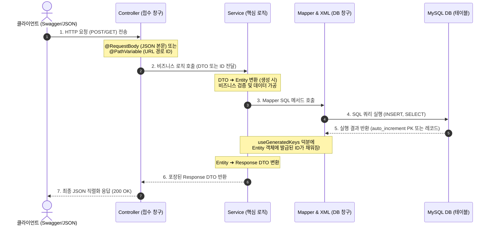

# 🍃 Spring Boot 전체 실습 마스터 가이드 & 개발 백서

> **저장소**: [https://github.com/minjae0529-blip/spring-boot.git](https://github.com/minjae0529-blip/spring-boot.git)  
> 이 문서는 `study01` (기초 & 정적 서빙), `study02` (RESTful CRUD & JSON 직렬화), `study03` (도메인형 3-Tier 아키텍처 & MyBatis 연동)까지 학습한 모든 실습 내용을 총정리한 공식 개발 백서입니다.  
> **"왜 이 코드를 작성해야 하는지(이유)"**, **"어떤 원리로 동작하는지"**를 세세하게 기록하여 다음 실습이나 실무에서도 혼자서 완벽하게 구현할 수 있도록 작성되었습니다.

---

## 🛠️ 1부. 프로젝트 초기 생성 & 필수 환경 설정

새로운 프로젝트를 만들 때 혼자서도 헤매지 않도록, 실제 IntelliJ 화면의 클릭 위치와 각 설정의 역할을 정리했습니다.


### 🔴 IntelliJ 화면 번호별 클릭 위치 & 기능 이유

| 번호 | 화면 위치 | 해야 할 일 | 기능 및 이 코드가 필요한 이유 |
| :---: | :--- | :--- | :--- |
| **①** | **종속성 선택 목록** | 아래 4개 라이브러리 검색 후 체크 | 웹 서버 구동, 코드 단축, 자동 재시작, API 문서화 엔진 탑재 |
| **②** | **추가된 종속성** | 4개가 잘 들어갔는지 눈으로 검토 | 빠진 라이브러리가 없는지 최종 확인 |
| **③** | **[생성(C)] 버튼** | 파란색 버튼 클릭 | Maven 기반 스프링 부트 프로젝트 뼈대 생성 및 라이브러리 다운로드 |
| **④** | **우측 하단 알림창** | **`[어노테이션 처리 활성화]`** 클릭 | **★필수:** 롬복의 `@Getter`, `@Setter` 바이트코드 컴파일 지원 (안 누르면 에러 발생) |

---

### 📦 4대 필수 의존성(Dependencies)의 역할과 존재 이유

1. **`Spring Web` (`spring-boot-starter-web`)**
   * **역할**: 스프링 웹 MVC 프레임워크 + **내장 톰캣(Apache Tomcat) 웹 서버** 탑재
   * **왜 넣어야 하나요?**: 톰캣 서버를 별도로 설치/세팅하지 않아도 스프링 부트 실행만으로 8080 포트 웹 서버가 열리며, 브라우저의 HTTP 요청(`GET`, `POST` 등)을 받아 처리하는 컨트롤러 환경을 만듭니다.

2. **`Lombok` (`lombok`)**
   * **역할**: 자바의 고질적인 보일러플레이트(Getter, Setter, toString, 생성자 등) 자동 생성
   * **왜 넣어야 하나요?**: 필드가 10개인 클래스에서 수십 줄의 코드를 작성할 필요 없이 `@Data`, `@NoArgsConstructor`, `@AllArgsConstructor` 어노테이션 한 줄로 해결해 가독성을 극대화합니다.

3. **`Spring Boot DevTools`**
   * **역할**: 코드 변경 시 애플리케이션 자동 재시작(Live Reload)
   * **왜 넣어야 하나요?**: 자바 코드나 설정을 수정할 때마다 매번 수동으로 서버를 종료하고 다시 켜는 시간을 절약해 줍니다.

4. **`SpringDoc OpenAPI (Swagger UI)` (`springdoc-openapi-starter-webmvc-ui`)**
   * **역할**: 브라우저 웹 페이지에서 API를 문서화하고 직접 테스트할 수 있는 GUI 제공
   * **왜 넣어야 하나요?**: `POST`, `PUT`, `DELETE` 요청은 브라우저 주소창으로 직접 테스트할 수 없습니다. Postman 같은 별도 툴 없이도 브라우저(`http://localhost:8080/doc`)에서 [Try it out] 버튼으로 바로 테스트하고 프론트엔드 개발자와 소통할 수 있습니다.

---

### ⚙️ 환경설정 파일 상세 분석 (`application.yaml`)

```yaml
server:
  port: 8080 # 내장 톰캣이 열어줄 HTTP 포트 번호

spring:
  datasource:
    # JDBC URL: 로컬 MySQL 서버 3306 포트의 hanip_delivery11 데이터베이스 지정
    url: jdbc:mysql://localhost:3306/hanip_delivery11
    username: root
    password: 1q2w3e4r!
    driver-class-name: com.mysql.cj.jdbc.Driver

# ⚠️ mybatis 설정은 spring 하위가 아니라 최상위(들여쓰기 0칸)에 위치해야 합니다!
mybatis:
  # Mapper XML 파일의 물리적 위치를 지정 (resources/mapper/ 하위 모든 xml)
  mapper-locations:
    - classpath:mapper/**/*.xml
    - classpath:mapper/*.xml
  configuration:
    # ★핵심: DB의 snake_case(customer_id) 컬럼을 자바의 camelCase(customerId) 필드에 자동 매핑!
    map-underscore-to-camel-case: true
  # XML에서 parameterType이나 resultType을 패키지 전체 경로 대신 클래스명만 쓸 수 있게 별칭 패키지 지정
  type-aliases-package: com.korai.study03.domain

# Swagger 접속 경로 커스텀
# 기본 주소 대신 간결하게 http://localhost:8080/doc 로 접속 가능하게 변경
springdoc:
  swagger-ui:
    path: /doc
```

---

## 🏗️ 2부. 3-Tier 아키텍처 & 6단계 구현 표준 공식

스프링 부트 실무 개발은 **"가장 안쪽(DB)부터 바깥쪽(Controller/웹)"**으로 나오는 **6단계 순서**로 구현해야 의존성이 꼬이지 않고 컴파일 에러 없이 완성할 수 있습니다.


### 🔄 데이터 라이프사이클 (순환 흐름도)



---

### 📋 6단계 구현 공식 (어디에 무엇을 만들어야 하는가?)

```
[Step 1. Entity] ➔ [Step 2. Request DTO] ➔ [Step 3. Mapper/XML] ➔ [Step 4. Service] ➔ [Step 5. Response DTO] ➔ [Step 6. Controller]
  (DB 원본 뼈대)        (입력 포장 상자)         (SQL & 키 수령)        (핵심 요리/로직)          (출력 포장 상자)          (접수 창구/URL)
```

1. **Step 1: Entity (`domain/{기능}/entity/`)**
   * **이유**: DB 테이블 컬럼과 1:1로 매핑되는 자바 원본 객체입니다. 데이터의 기준이 되므로 가장 먼저 만듭니다.
2. **Step 2: Request DTO (`domain/{기능}/dto/`)**
   * **이유**: 클라이언트가 보낼 값만 안전하게 정의합니다. 아직 DB에 들어가기 전이므로 PK(`id`)는 제외합니다. 엔티티로 바꾸는 `toEntity()` 메서드를 내장합니다.
3. **Step 3: Mapper & XML (`domain/{기능}/mapper/`, `resources/mapper/`)**
   * **이유**: DB와 대화하는 SQL 창구입니다. `useGeneratedKeys="true"`로 auto_increment 번호를 회수합니다.
4. **Step 4: Service (`domain/{기능}/service/`)**
   * **이유**: 비즈니스 로직을 처리하는 주방장입니다. DTO ➔ Entity 변환 ➔ DB 저장 ➔ Response DTO 변환을 총괄합니다.
5. **Step 5: Response DTO (`domain/{기능}/dto/`)**
   * **이유**: DB 저장이 완료된 후 발급된 PK를 포함해 클라이언트에게 보여줄 필드만 선별해 응답합니다.
6. **Step 6: Controller (`domain/{기능}/controller/`)**
   * **이유**: URL 주소를 열고 HTTP 메서드를 매핑하여 손님을 맞이합니다.

---

## 📂 3부. 프로젝트별 상세 구현 & 코드 의미 분석

---

### 1. 📌 `study01` - 스프링 부트 기초 & 뷰/데이터 분리

#### 🎯 핵심 개념 & 코드 의미
* **서블릿과 스프링의 구조적 차이**:
  * 서블릿: `doGet()`, `doPost()` 클래스 하나가 요청 1개를 전담
  * 스프링: **메서드 하나가 요청 1개를 전담**하므로 하나의 컨트롤러 클래스에 수십 개의 API 메서드를 담을 수 있음
* **`@Controller` vs `@RestController`**:
  * `@Controller`: 메서드의 `return` 값을 **"HTML/JSP 화면 경로"**로 해석 (`return "/upload/index.html"`)
  * `@ResponseBody`: `@Controller` 환경에서 특정 메서드만 화면이 아닌 **"순수 데이터(문자열/JSON)"**를 반환하도록 지시
  * `@RestController`: `@Controller + @ResponseBody`의 합체형으로 클래스 내 모든 메서드가 데이터를 반환
* **정적 자원(Static Resources) 경로 규칙**:
  * `src/main/resources/static/` 폴더가 브라우저 웹 상의 루트(`/`)가 됨
  * `static/upload/test.pdf` 파일은 `http://localhost:8080/upload/test.pdf`로 바로 접근 가능

---

### 2. 📌 `study02` - RESTful API 기본 & JSON 자동 직렬화

#### 🎯 핵심 개념 & 코드 의미
* **HTTP 4대 메서드 매핑 (CRUD)**:
  * `@GetMapping`: 조회 (Read) - 브라우저 주소창에서 엔터 치면 기본 호출됨
  * `@PostMapping`: 등록/생성 (Create) - 브라우저 주소창 입력 시 405 Method Not Allowed 발생 (Swagger/Postman 필요)
  * `@PutMapping`: 전체 수정 (Update)
  * `@DeleteMapping`: 삭제 (Delete)
* **Jackson 라이브러리의 JSON 자동 변환 (직렬화)**:
  * 스프링 부트는 컨트롤러가 Java 컬렉션을 반환하면 자동으로 JSON 규격으로 변환합니다:
    * `List<String>` ➔ `["사과", "바나나", "포도"]` (JSON Array)
    * `Map<String, Object>` ➔ `{"name": "홍길동", "age": 25}` (JSON Object)
    * `List<Map<String, Object>>` ➔ `[{"id": 1, "name": "김철수"}, {"id": 2, "name": "이영희"}]` (JSON Object Array)

---

### 3. 📌 `study03` - 실무 도메인 주도 아키텍처 & MyBatis 연동

#### 🗂️ 도메인 1: 고객 (`Customer`) - [신규 등록 POST]
* **목적**: 신규 고객 정보를 JSON으로 받아 DB에 INSERT하고, 발급된 `customerId`를 포함해 응답
* **핵심 구현 흐름 & 코드 이유**:
  1. **`CustomerCreateRequest.java`**:
     * 사용자가 입력할 이름, 연락처, 생년월일 등만 선언 (PK 제외)
     * `toCustomer()` 메서드: `new Customer(0, name, ..., LocalDateTime.now())` 로 변환하여 초기 ID=0과 가입일시를 세팅
  2. **`customer-mapper.xml`**:
     * `useGeneratedKeys="true" keyProperty="customerId"`: MySQL이 채번한 PK를 `Customer` 객체에 즉시 주입
  3. **`CustomerService.java`**:
     * `Customer customer = request.toCustomer();` 로 만든 객체를 `customerMapper.insert(customer);` 에 **그대로 전달**해야 ID가 채워짐
  4. **`CustomerResponse.java`**:
     * `toCustomerResponse()`로 발급된 ID를 담아 클라이언트에 200 OK로 반환

#### 🗂️ 도메인 2: 식당 (`Restaurant`) - [신규 등록 POST]
* **목적**: 음식점 기본 정보 및 영업시간, 운영 상태 등록
* **해결한 핵심 이슈**:
  * `openTime`(영업 시작 시간)과 `isOpen`(영업 중 여부)의 이름 충돌 해결
  * 롬복은 `boolean isOpen;`의 getter를 `isOpen()`으로 만들어 JSON에서 `open`으로 축약하므로 변수명을 명확히 분리 매핑

#### 🗂️ 도메인 3: 고객 쿠폰 (`CustomerCoupon`) - [목록 조회 & 단건 조회]
* **목적**: 특정 고객이 보유한 쿠폰 전체 목록 및 특정 쿠폰 상세 조회
* **핵심 구현 흐름 & 코드 이유**:
  1. **전체 목록 조회 (`GET /api/customers/{customerId}/coupons`)**:
     * `@PathVariable int customerId`: URL 경로에서 고객 번호를 추출
     * **메서드 참조 (`::`) 스트림 변환**:
       ```java
       return customerCouponMapper.findAll(customerId)
               .stream()
               .map(CustomerCoupon::toCustomerCouponResponse) // c -> c.toCustomerCouponResponse() 축약
               .toList();
       ```
  2. **단건 조회 (`GET /api/customers/{customerId}/coupons/{customerCouponId}`)**:
     * `@PathVariable int customerCouponId`: 특정 쿠폰 고유 번호를 받아 1건 조회 후 DTO 변환

#### 🗂️ 도메인 4: 쿠폰 마스터 (`Coupon`) - [쿠폰 발행 템플릿 등록]
* **목적**: 관리자가 새로운 할인 쿠폰(코드, 할인 금액, 최소 주문 금액 등)을 발행/등록
* **핵심 구현 포인트**:
  * `CouponCreateRequest`에서 서버가 채울 `createdAt` 제외
  * `toCoupon()`과 `toCouponResponse()` 변환 메서드를 통한 객체 라이프사이클 확립

---

## 🔍 4부. 파라미터 어노테이션 완전 정복

| 어노테이션 | 적용 계층 | 사용 예시 URL / 코드 | 왜 이 어노테이션을 쓰는가? |
| :--- | :---: | :--- | :--- |
| **`@RequestBody`** | **컨트롤러** | `POST /api/customers`<br>`@RequestBody CustomerCreateRequest req` | • 클라이언트가 HTTP 본문(Body)에 실어 보낸 **JSON 데이터**를 자바 DTO 객체로 변환해 채워줌<br>• 없으면 필드가 전부 `null`이 됨 |
| **`@PathVariable`** | **컨트롤러** | `GET /api/customers/`**`15`**<br>`@GetMapping("/{id}") (@PathVariable int id)` | • **URL 주소 경로에 포함된 고유 식별자(PK)**를 꺼내올 때 사용<br>• 특정 단건 조회, 단건 삭제 등에 필수 |
| **`@RequestParam`** | **컨트롤러** | `GET /api/customers?`**`grade=VIP&page=1`**<br>`@RequestParam String grade` | • 주소창 뒤의 **쿼리스트링(?key=value)**으로 넘어온 검색어, 필터, 페이징 값을 꺼낼 때 사용 |
| **`@Param`** | **MyBatis 매퍼** | `List<Coupon> find(@Param("cid") int id)` | • 자바 매퍼 인터페이스의 변수를 **XML 쿼리의 `#{cid}` 파라미터로 연결하는 이름표** 역할 |

---

## 🚨 5부. 실습 중 자주 겪는 4대 에러 & 해결 체크리스트

1. **`NullPointerException` (컨트롤러에서 서비스 호출 시)**
   * **원인**: 컨트롤러에 `@Autowired private XxxService xxxService;` 주입이 누락되어 변수가 `null`인 상태로 메서드를 호출함
   * **해결**: `@Autowired` 어노테이션을 붙여 스프링이 객체를 주입하게 함

2. **`ReflectionException: There is no getter for property 'xxx'...`**
   * **원인**: XML의 `#{변수명}`과 엔티티 클래스의 필드명이 철자 하나라도 불일치함 (예: `birthDay` vs `birthDate`)
   * **해결**: XML 변수명과 엔티티 변수명을 대소문자까지 동일하게 맞춤

3. **`Cannot instantiate class...` (MyBatis SELECT 시 500 에러)**
   * **원인**: MyBatis가 쿼리 결과를 객체로 만들 때 사용하는 **기본 생성자**가 엔티티 클래스에 없음
   * **해결**: 엔티티 클래스 위에 **`@NoArgsConstructor`** 추가

4. **INSERT 후 자바 객체의 ID가 여전히 0인 현상**
   * **원인 1**: XML에 `useGeneratedKeys="true" keyProperty="id"` 설정 누락
   * **원인 2**: 서비스에서 `mapper.insert(request.toEntity())` 처럼 매퍼에 새 객체를 넘겨버려 이미 만든 변수에 ID가 채워지지 않음
   * **해결**: 미리 선언한 `Coupon coupon = request.toCoupon();` 변수를 그대로 `mapper.insert(coupon);` 에 전달

---

## 🚀 6부. GitHub 원격 저장소 동기화 (Git Push)

현재 작성된 모든 코드와 문서를 GitHub 저장소로 푸시하는 명령어입니다:

```bash
# 1. 변경된 모든 파일 스테이징
git add .

# 2. 커밋 메시지 작성
git commit -m "feat: complete spring boot study (study01, study02, study03 with guides)"

# 3. 원격 저장소 등록 (최초 1회)
git remote add origin https://github.com/minjae0529-blip/spring-boot.git

# 4. 기본 브랜치 이름을 main으로 지정
git branch -M main

# 5. 원격 저장소로 푸시
git push -u origin main
```
