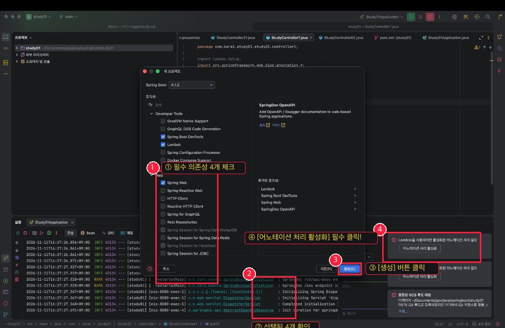
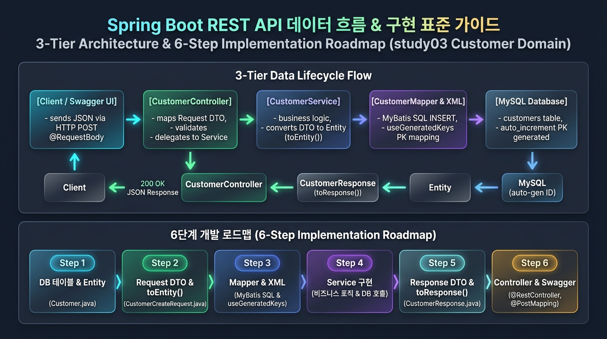
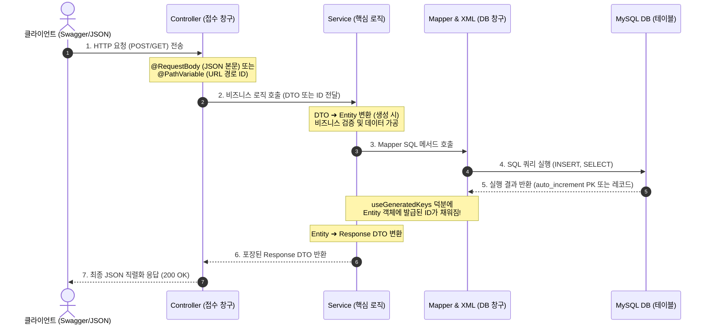

# 🍃 Spring Boot 전체 실습 마스터 가이드 & 개발 백서

> **저장소**: [https://github.com/minjae0529-blip/spring-boot.git](https://github.com/minjae0529-blip/spring-boot.git)  
> 이 문서는 `study01` (기초 & 서블릿 비교), `study02` (RESTful CRUD & JSON 변환), `study03` (도메인형 3-Tier 아키텍처 & MyBatis 연동)까지 학습한 모든 실습 내용을 총정리한 공식 개발 백서입니다.  
> **"왜 이 코드를 작성해야 하는지(이유)"**, **"각 클래스가 어떤 역할을 하며 내부 코드가 어떻게 작동하는지"**, 그리고 **"실습 중 질문했던 핵심 개념(Q&A)"**을 세세하게 기록했습니다.

---

## 🛠️ 1부. 프로젝트 초기 생성 & 필수 환경 설정

새로운 프로젝트를 만들 때 혼자서도 헤매지 않도록, 실제 IntelliJ 화면의 클릭 위치와 각 설정의 역할을 정리했습니다.



### 🔴 IntelliJ 화면 번호별 클릭 위치 & 기능 이유

| 번호 | 화면 위치 | 해야 할 일 | 기능 및 이 코드가 필요한 이유 |
| :---: | :--- | :--- | :--- |
| **①** | **종속성 선택 목록** | 아래 4개 라이브러리 검색 후 체크 | 웹 서버 구동, 코드 단축, 자동 재시작, API 문서화 엔진 탑재 |
| **②** | **추가된 종속성** | 4개가 잘 들어갔는지 눈으로 검토 | 빠진 라이브러리가 없는지 최종 확인 |
| **③** | **[생성(C)] 버튼** | 파란색 버튼 클릭 | Maven 기반 스프링 부트 프로젝트 뼈대 생성 및 라이브러리 다운로드 |
| **④** | **우측 하단 알림창** | **`[어노테이션 처리 활성화]`** 클릭 | **★필수:** 롬복의 `@Getter`, `@Setter` 바이트코드 컴파일 지원 (안 누르면 에러 발생) |

---

### 📦 4대 필수 의존성(Dependencies)의 역할과 존재 이유

1. **`Spring Web` (`spring-boot-starter-web`)**
   * **역할**: 스프링 웹 MVC 프레임워크 + **내장 톰캣(Apache Tomcat) 웹 서버** 탑재
   * **왜 넣어야 하나요?**: 톰캣 서버를 별도로 설치/세팅하지 않아도 스프링 부트 실행만으로 8080 포트 웹 서버가 열리며, 브라우저의 HTTP 요청(`GET`, `POST` 등)을 받아 처리하는 컨트롤러 환경을 만듭니다.

2. **`Lombok` (`lombok`)**
   * **역할**: 자바의 보일러플레이트(Getter, Setter, toString, 생성자 등) 자동 생성
   * **왜 넣어야 하나요?**: 필드가 10개인 클래스에서 수십 줄의 코드를 일일이 작성할 필요 없이 `@Data`, `@NoArgsConstructor`, `@AllArgsConstructor` 어노테이션 한 줄로 해결해 가독성을 극대화합니다.

3. **`Spring Boot DevTools`**
   * **역할**: 코드 변경 시 애플리케이션 자동 재시작(Live Reload)
   * **왜 넣어야 하나요?**: 자바 코드나 설정을 수정할 때마다 매번 수동으로 서버를 종료하고 다시 켜는 시간을 절약해 줍니다.

4. **`SpringDoc OpenAPI (Swagger UI)` (`springdoc-openapi-starter-webmvc-ui`)**
   * **역할**: 브라우저 웹 페이지에서 API를 문서화하고 직접 테스트할 수 있는 GUI 제공
   * **왜 넣어야 하나요?**: `POST`, `PUT`, `DELETE` 요청은 브라우저 주소창으로 직접 테스트할 수 없습니다. Postman 같은 별도 툴 없이도 브라우저(`http://localhost:8080/doc`)에서 [Try it out] 버튼으로 바로 테스트하고 프론트엔드 개발자와 소통할 수 있습니다.

---

### ⚙️ 환경설정 파일 상세 분석 (`application.yaml`)

```yaml
server:
  port: 8080 # 내장 톰캣이 열어줄 HTTP 포트 번호

spring:
  datasource:
    # JDBC URL: 로컬 MySQL 서버 3306 포트의 hanip_delivery11 데이터베이스 지정
    url: jdbc:mysql://localhost:3306/hanip_delivery11
    username: root
    password: 1q2w3e4r!
    driver-class-name: com.mysql.cj.jdbc.Driver

# ⚠️ mybatis 설정은 spring 하위가 아니라 최상위(들여쓰기 0칸)에 위치해야 합니다!
mybatis:
  # Mapper XML 파일의 물리적 위치를 지정 (resources/mapper/ 하위 모든 xml)
  mapper-locations:
    - classpath:mapper/**/*.xml
    - classpath:mapper/*.xml
  configuration:
    # ★핵심: DB의 snake_case(customer_id) 컬럼을 자바의 camelCase(customerId) 필드에 자동 매핑!
    map-underscore-to-camel-case: true
  # XML에서 parameterType이나 resultType을 패키지 전체 경로 대신 클래스명만 쓸 수 있게 별칭 패키지 지정
  type-aliases-package: com.korai.study03.domain

# Swagger 접속 경로 커스텀
# 기본 주소 대신 간결하게 http://localhost:8080/doc 로 접속 가능하게 변경
springdoc:
  swagger-ui:
    path: /doc
```

---

## 🏗️ 2부. 3-Tier 아키텍처 & 6단계 구현 표준 공식

스프링 부트 실무 개발은 **"가장 안쪽(DB)부터 바깥쪽(Controller/웹)"**으로 나오는 **6단계 순서**로 구현해야 의존성이 꼬이지 않고 컴파일 에러 없이 완성할 수 있습니다.



### 🔄 데이터 라이프사이클 (순환 흐름도)



---

### 📋 6단계 구현 공식 (어디에 무엇을 만들어야 하는가?)

```
[Step 1. Entity] ➔ [Step 2. Request DTO] ➔ [Step 3. Mapper/XML] ➔ [Step 4. Service] ➔ [Step 5. Response DTO] ➔ [Step 6. Controller]
  (DB 원본 뼈대)        (입력 포장 상자)         (SQL & 키 수령)        (핵심 요리/로직)          (출력 포장 상자)          (접수 창구/URL)
```

---

## 🌳 3부. 패키지별 클래스 구성 및 코드 작동 원리 상세 분석

현재 인텔리제이의 `study03` 패키지 구조 그대로 각 클래스가 무슨 일을 하고 코드가 어떻게 돌아가는지 세세하게 분석합니다.

```text
📁 study03/src/main/java/com/korai/study03/
├── 📄 Study03Application.java
└── 📁 domain/
    ├── 📁 customer/        (고객 도메인 - 등록 C)
    ├── 📁 restaurant/      (식당 도메인 - 등록 C)
    ├── 📁 customerCoupon/  (고객 쿠폰 도메인 - 조회 R)
    └── 📁 coupon/          (쿠폰 마스터 도메인 - 등록 C)
```

---

### 🗂️ 1. 고객 도메인 (`domain/customer/`)

#### ① `entity/Customer.java` (DB 원본 엔티티)
* **역할**: MySQL의 `customers` 테이블과 1:1로 매핑되는 자바 원본 뼈대입니다.
* **작동 원리**:
  * `@Data`, `@NoArgsConstructor`, `@AllArgsConstructor`: MyBatis가 DB에서 레코드를 가져와 객체를 만들 때 필요한 기본 생성자와 Getter/Setter를 지원합니다.
  * `customerId`: DB의 `customer_id` PK와 매핑됩니다.
  * `toCustomerResponse()`: DB 저장이 끝난 후 발급된 `customerId`를 포함하여 응답 DTO(`CustomerResponse`) 객체로 변환하여 리턴합니다.

#### ② `dto/CustomerCreateRequest.java` (요청 DTO)
* **역할**: 클라이언트(Swagger/웹)가 POST 요청 시 JSON 본문에 실어 보내는 데이터만 담는 포장 상자입니다.
* **작동 원리**:
  * 아직 등록 전이므로 DB가 발급해 줄 `customerId`는 필드에 없습니다.
  * `toCustomer()`: 클라이언트가 보낸 값에 `customerId = 0`과 `joinedAt = LocalDateTime.now()`를 조합하여 완벽한 `Customer` 엔티티 객체로 조립해 줍니다.

#### ③ `dto/CustomerResponse.java` (응답 DTO)
* **역할**: DB 저장이 완료된 후 클라이언트에게 200 OK와 함께 돌려줄 응답 포장 상자입니다.
* **작동 원리**:
  * DB `auto_increment`로 발급된 진짜 ID 번호(`id`)를 담아서 반환하며, 클라이언트 화면에 보여줄 데이터만 깔끔하게 전달합니다.

#### ④ `mapper/CustomerMapper.java` & `resources/mapper/customer-mapper.xml`
* **역할**: DB와 직접 대화하여 SQL을 실행하는 영속성 계층입니다.
* **작동 원리**:
  * `CustomerMapper`: `@Mapper` 어노테이션이 붙어 스프링이 구현체를 자동 생성합니다.
  * `customer-mapper.xml`:
    ```xml
    <insert id="insert" useGeneratedKeys="true" keyProperty="customerId" parameterType="com.korai.study03.domain.customer.entity.Customer">
        insert into customers
        values (default, #{name}, #{phone}, #{email}, #{birthDate}, #{district}, #{address}, #{grade}, #{marketingAgreed}, #{joinedAt})
    </insert>
    ```
    * `useGeneratedKeys="true"`: MySQL이 채번한 auto_increment 번호를 가져오겠다는 선언입니다.
    * `keyProperty="customerId"`: 가져온 번호를 전달된 `Customer` 객체의 `customerId` 변수에 즉시 채워줍니다.

#### ⑤ `service/CustomerService.java` (비즈니스 로직)
* **역할**: 실제 등록 로직을 수행하는 주방장입니다.
* **작동 원리**:
  ```java
  public CustomerResponse create(CustomerCreateRequest request){
      Customer customer = request.toCustomer(); // 1. DTO -> Entity 변환 (ID=0)
      customerMapper.insert(customer);          // 2. DB 저장 (customer 변수에 발급된 ID가 채워짐!)
      return customer.toCustomerResponse();     // 3. Entity -> Response DTO 변환 후 리턴
  }
  ```

#### ⑥ `controller/CustomerController.java` (웹 요청 접수처)
* **역할**: 외부 웹 요청을 가장 먼저 받아 서비스로 연결해 주는 문지기입니다.
* **작동 원리**:
  * `@RequestMapping("/api/customers")`: 공통 URL 지정
  * `@PostMapping`: POST 방식으로 들어온 요청을 처리
  * `@RequestBody CustomerCreateRequest request`: HTTP 요청 본문(Body)에 담긴 JSON을 자바 객체로 변환하여 수신
  * `customerService.create(request)`를 호출하고, 완성된 `CustomerResponse`를 반환하면 스프링이 JSON으로 직렬화하여 클라이언트에 200 OK 응답합니다.

---

### 🗂️ 2. 식당 도메인 (`domain/restaurant/`)

#### 클래스 구성 & 작동 원리
* `Restaurant.java`: `restaurantId`, `openTime`, `closeTime`, `openedAt`, `isOpen` 등 식당 기본 정보 엔티티
* `RestaurantCreateRequest.java`: 식당 등록 요청 DTO (`toRestaurant()` 변환 메서드 포함)
* `RestaurantResponse.java`: 식당 등록 응답 DTO
* `RestaurantMapper.java` & `restaurant-mapper.xml`: `insert into restaurants values (...)` 쿼리 실행
* `RestaurantService.java`: DTO ➔ Entity 변환 ➔ INSERT ➔ Response DTO 변환 처리
* `RestaurantController.java`: `POST /api/restaurants` 엔드포인트를 열어 등록 처리

---

### 🗂️ 3. 고객 쿠폰 도메인 (`domain/customerCoupon/`) - [조회 R]

#### 클래스 구성 & 작동 원리
* `CustomerCoupon.java`: `customerCouponId`, `customerId`, `couponId`, `issuedAt`, `expiresAt`, `usedOrderId` 필드를 가진 엔티티
* `CustomerCouponResponse.java`: 쿠폰 조회 결과를 담는 응답 DTO
* `CustomerCouponMapper.java`:
  * `List<CustomerCoupon> findAll(@Param("customerId") int customerId);`
  * `CustomerCoupon findById(@Param("customerCouponId") int customerCouponId);`
* `customer-coupon-mapper.xml`:
  * `<select id="findAll">` : `where customer_id = #{customerId}` 조건으로 해당 고객의 모든 쿠폰 조회
  * `<select id="findById">` : `where customer_coupon_id = #{customerCouponId}` 조건으로 단건 조회
* `CustomerCouponService.java`:
  * **전체 목록 조회**:
    ```java
    public List<CustomerCouponResponse> getAll(int customerId){
        return customerCouponMapper.findAll(customerId)
                .stream()
                .map(CustomerCoupon::toCustomerCouponResponse) // 메서드 참조(::)로 DTO 변환
                .toList();
    }
    ```
  * **단건 조회**:
    ```java
    public CustomerCouponResponse getId(int customerCouponId){
        CustomerCoupon coupon = customerCouponMapper.findById(customerCouponId);
        if (coupon == null) return null;
        return coupon.toCustomerCouponResponse();
    }
    ```
* `CustomerCouponController.java`:
  * `GET /api/customers/{customerId}/coupons` ➔ `getAll(@PathVariable int customerId)`
  * `GET /api/customers/{customerId}/coupons/{customerCouponId}` ➔ `getId(@PathVariable int customerCouponId)`

---

### 🗂️ 4. 쿠폰 마스터 도메인 (`domain/coupon/`) - [신규 등록 C]

#### 클래스 구성 & 작동 원리
* `Coupon.java`: `id`, `code`, `name`, `discountType`, `discountValue`, `maxDiscount`, `minOrderAmount`, `validDays`, `isActive`, `createdAt` 엔티티
* `CouponCreateRequest.java`: 신규 쿠폰 템플릿 등록 DTO (`toCoupon()` 변환 메서드 포함)
* `CouponResponse.java`: 쿠폰 등록 결과 응답 DTO
* `CouponMapper.java` & `coupon-mapper.xml`: `insert into coupons values (...)` 쿼리 실행
* `CouponService.java`: 쿠폰 비즈니스 로직
* `CouponController.java`: `POST /api/coupons` 요청 처리

---

## ❓ 4부. 실습하며 질문했던 핵심 개념 총정리 (Q&A)

### Q1. `@RequestBody`는 왜 들어가며, JSON 말고 다른 데이터는 어떻게 받나요?
* **이유**: 클라이언트(React, Vue, 모바일 앱 등)는 데이터를 HTTP 본문(Body)에 **JSON 글자** 형태로 실어 보냅니다. 스프링에게 **"본문에 들어있는 JSON을 읽어서 자바 DTO 객체로 변환해 줘!"** 라고 지시하는 어노테이션이 바로 `@RequestBody`입니다.
* **JSON이 아닐 때 사용하는 어노테이션 비교**:
  * **`@RequestBody`**: HTTP Body의 JSON 데이터 (REST API, 프론트엔드 전송)
  * **`@RequestParam`**: 주소창 뒤 물음표 쿼리스트링 (`?category=한식&page=1`) ➔ 검색, 필터링, 페이징
  * **`@PathVariable`**: URL 주소 경로 자체에 포함된 고유 ID (`/api/customers/15`) ➔ 단건 조회/삭제
  * **`@ModelAttribute`**: HTML `<form>` 전송 및 파일 업로드 (`multipart/form-data`)

---

### Q2. `CreateRequest`에는 왜 `int id`를 명시하지 않나요?
* **이유**: 신규 등록(Create) 시점에는 **아직 ID가 세상에 존재하지 않기 때문**입니다.
* 은행에서 통장을 신규 개설할 때 신청서에 이름과 전화번호는 적지만 "계좌번호"는 비워두는 것과 같습니다. 계좌번호는 전산(DB)이 `auto_increment`로 발급해 주는 번호이므로, 손님이 보낼 필요가 없어 `CreateRequest`에서는 제외합니다. (발급된 ID는 `Response`에만 포함됩니다.)

---

### Q3. `::` (이중 콜론)은 무엇인가요?
* **정의**: 자바 8에서 도입된 **"메서드 참조 (Method Reference)"** 문법입니다.
* **역할**: 람다식(`->`)을 더 짧고 간결하게 쓰기 위한 문법적 단축키입니다.
  * **람다식**: `list.stream().map(c -> c.toCustomerResponse()).toList();`
  * **메서드 참조**: `list.stream().map(Customer::toCustomerResponse).toList();`
  * 의미: *"Customer 클래스에 있는 `toCustomerResponse` 메서드를 그대로 실행해서 변환해라!"*

---

### Q4. `Param`과 `PathVariable`의 차이는 무엇인가요?
* **`@PathVariable` (스프링 컨트롤러)**: URL 경로 자체에 들어있는 값 (`/api/customers/{customerId}`)
* **`@RequestParam` (스프링 컨트롤러)**: 주소창 뒤의 물음표 쿼리스트링 (`/api/customers?grade=VIP`)
* **`@Param` (MyBatis 매퍼)**: 자바 매퍼 인터페이스의 파라미터를 **XML SQL의 `#{...}`로 연결해 주는 이름표**

---

### Q5. 변환 메서드(`toEntity`, `toResponse`)는 왜 만드나요?
* **이유**: 클라이언트가 보낸 **신청서(`Request DTO`)**와 DB에 들어가는 **원본(`Entity`)**, 그리고 클라이언트에게 줄 **영수증(`Response DTO`)**은 서로 생김새(필드 구성)가 다릅니다.
* 변환 메서드가 없으면 Service에서 매번 수십 줄의 Getter/Setter 노가다 코드를 작성해야 하지만, 변환 메서드를 DTO와 Entity 안에 만들어 두면 Service 코드가 단 3줄로 깔끔해집니다:
  ```java
  Coupon coupon = request.toCoupon();       // 1. DTO -> Entity 변환
  couponMapper.insert(coupon);              // 2. DB 저장
  return coupon.toCouponResponse();         // 3. Entity -> Response DTO 변환 후 리턴
  ```

---

### Q6. 컴포넌트(Component) vs 엔티티(Entity) / 데이터 객체는 왜 다를까요? (★필독!)
메모장에 기록해둔 가장 중요한 스프링의 핵심 원칙입니다:
* **컴포넌트 (`@Component`, `@Controller`, `@Service`, `@Repository`)**:
  * **역할**: **"자동 조립(DI)될 수 있는 일꾼들"**
  * **생명주기**: **싱글톤(Singleton)**으로 동작합니다. 스프링 서버가 켜질 때 딱 1개만 만들어져서 메모리에 계속 상주하며 여러 사람의 요청을 처리합니다.
  * **절대 금지**: 상태(개인 데이터)를 필드에 저장하면 다른 사용자 요청과 엉켜 대형 사고가 납니다!
* **엔티티(`Entity`) 또는 DTO(`Request/Response`) 데이터 객체**:
  * **역할**: 데이터베이스의 레코드나 손님이 보낸 데이터 그 자체를 담는 **"데이터 바구니"**
  * **생명주기**: 필요할 때마다 개발자가 **`new`** 로 직접 생성해서 쓰고 버립니다 (`toCustomer()` 등).
  * **★절대 금지 규칙**: **엔티티나 DTO에는 절대로 `@Component` 같은 컴포넌트 어노테이션을 달면 안 됩니다!**
    * 이유: 데이터 객체는 요청마다 값이 다르고 계속 새로 만들어져야 하는데, 컴포넌트를 붙여버리면 스프링이 싱글톤으로 딱 1개만 만들어서 모든 사람의 데이터가 하나로 덮어씌워지는 치명적인 버그가 발생합니다!

---

### Q7. Swagger 기본 주소와 커스텀 주소는 왜 다른가요?
* **기본 임시 사이트 주소**: `http://localhost:8080/swagger-ui/index.html`
  * 백엔드 개발자가 API를 만들고 프론트엔드 개발자에게 명세서로 전달하기 위해 제공되는 테스트 페이지입니다.
* **커스텀 주소**: `application.yaml`에 `springdoc.swagger-ui.path: /doc` 한 줄을 설정해두면:
  * 외우기 힘든 긴 주소 대신 **`http://localhost:8080/doc`** 로 간편하게 바로 접속할 수 있습니다!

---

### Q8. 왜 Swagger나 JSON에서 `open` 변수가 사라지거나 충돌이 났을까요?
* **이유**: 자바와 롬복(Lombok)은 `boolean` 타입의 Getter를 만들 때 `getIsOpen()`이 아니라 **앞의 `is`를 뗀 `isOpen()`** 형태로 만듭니다.
* 그 결과 `LocalTime open;` (영업시간)과 `boolean isOpen;` (영업여부) 둘 다 JSON 변환기(Jackson)가 볼 때는 똑같이 `"open"`이라는 이름으로 해석하여 서로 덮어씌워지는 충돌이 발생한 것입니다.
* **해결**: `boolean opened;` 처럼 이름을 명확히 분리하거나, `@JsonProperty("isOpen")`을 붙여 해결합니다.

---

## 🚨 5부. 실습 중 자주 겪는 4대 에러 & 해결 체크리스트

1. **`NullPointerException` (컨트롤러에서 서비스 호출 시)**
   * **원인**: 컨트롤러에 `@Autowired private XxxService xxxService;` 주입이 누락되어 변수가 `null`인 상태로 메서드를 호출함
   * **해결**: `@Autowired` 어노테이션을 붙여 스프링이 객체를 주입하게 함

2. **`ReflectionException: There is no getter for property 'xxx'...`**
   * **원인**: XML의 `#{변수명}`과 엔티티 클래스의 필드명이 철자 하나라도 불일치함 (예: `birthDay` vs `birthDate`)
   * **해결**: XML 변수명과 엔티티 변수명을 대소문자까지 동일하게 맞춤

3. **`Cannot instantiate class...` (MyBatis SELECT 시 500 에러)**
   * **원인**: MyBatis가 쿼리 결과를 객체로 만들 때 사용하는 **기본 생성자**가 엔티티 클래스에 없음
   * **해결**: 엔티티 클래스 위에 **`@NoArgsConstructor`** 추가

4. **INSERT 후 자바 객체의 ID가 여전히 0인 현상**
   * **원인 1**: XML에 `useGeneratedKeys="true" keyProperty="id"` 설정 누락
   * **원인 2**: 서비스에서 `mapper.insert(request.toEntity())` 처럼 매퍼에 새 객체를 넘겨버려 이미 만든 변수에 ID가 채워지지 않음
   * **해결**: 미리 선언한 `Coupon coupon = request.toCoupon();` 변수를 그대로 `mapper.insert(coupon);` 에 전달

---

## 🚀 6부. GitHub 원격 저장소 동기화 (Git Push)

현재 작성된 모든 코드와 문서를 GitHub 저장소로 푸시하는 명령어입니다:

```bash
git add .
git commit -m "docs: update comprehensive README with package details, class workflows, and Q&A"
git push origin main
```
