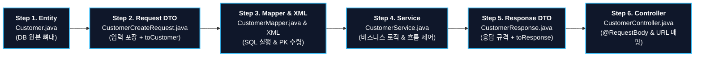

# 🚀 Spring Boot REST API 구현 순서 및 코드 총정리 가이드 (study03 Customer 도메인)

> **이 문서는 브라우저 및 인텔리제이에서 전체 페이지로 한눈에 보고 실습에 그대로 적용할 수 있도록 작성된 완전판 가이드입니다.**

---

## 📌 한눈에 보는 6단계 구현 흐름



---

## 1단계: Entity (`Customer.java`)
> **역할**: **"데이터베이스(MySQL) 테이블과 1:1로 매핑되는 원본 자바 객체"**  
> 모든 비즈니스와 데이터의 가장 중심이 되는 기준점입니다.

### 📄 전체 코드
```java
package com.korai.study03.domain.customer.entity;

import com.korai.study03.domain.customer.dto.CustomerResponse;
import lombok.AllArgsConstructor;
import lombok.Data;
import lombok.NoArgsConstructor;

import java.time.LocalDate;
import java.time.LocalDateTime;

@Data                       // Getter, Setter, toString, equals 등을 자동 생성
@NoArgsConstructor          // 파라미터 없는 기본 생성자 Customer() 자동 생성
@AllArgsConstructor         // 모든 필드를 파라미터로 받는 생성자 자동 생성
public class Customer {
    private int customerId;           // PK (DB의 customer_id와 매핑, auto_increment)
    private String name;              // 고객 이름
    private String phone;             // 전화번호
    private String email;             // 이메일
    private LocalDate birthDate;      // 생년월일 (날짜만)
    private String district;          // 거주 구역 (예: 강남구)
    private String address;           // 상세 주소
    private String grade;             // 회원 등급 (예: BRONZE, VIP)
    private boolean marketingAgreed;  // 마케팅 동의 여부 (true/false)
    private LocalDateTime joinedAt;   // 가입 일시 (날짜 + 시간)

    /**
     * [변환 메서드] Entity -> Response DTO
     * DB에서 발급된 customerId를 포함하여 클라이언트에게 돌려줄 포장 상자로 변환
     */
    public CustomerResponse toCustomerResponse(){
        return new CustomerResponse(
                customerId,
                name,
                phone,
                email,
                birthDate,
                district,
                address,
                grade,
                marketingAgreed,
                joinedAt
        );
    }
}
```

---

## 2단계: Request DTO (`CustomerCreateRequest.java`)
> **역할**: **"클라이언트(웹 브라우저/Swagger)가 POST 요청 시 보내오는 JSON 데이터를 담는 가방"**  
> 사용자가 입력할 필요가 없는 PK(`customerId`)는 제외하고 필요한 필드만 정의합니다.

### 📄 전체 코드
```java
package com.korai.study03.domain.customer.dto;

import com.korai.study03.domain.customer.entity.Customer;
import lombok.Data;

import java.time.LocalDate;
import java.time.LocalDateTime;

@Data // Getter, Setter 등을 자동 생성하여 JSON 필드 매핑 지원
public class CustomerCreateRequest {
    // 네이밍 규칙: 엔티티명 + 기능/목적 + Request
    private String name;
    private String phone;
    private String email;
    private LocalDate birthDate;
    private String district;
    private String address;
    private String grade;
    private boolean marketingAgreed;

    /**
     * [변환 메서드] Request DTO -> Entity
     * 클라이언트가 보낸 데이터에 서버가 필요한 기본값(PK=0, 가입일=현재시간)을 채워 Entity로 조립
     */
    public Customer toCustomer(){
        return new Customer(
                0,                        // PK는 DB auto_increment가 넣어줄 것이므로 0으로 초기화
                name, 
                phone, 
                email, 
                birthDate, 
                district, 
                address, 
                grade, 
                marketingAgreed, 
                LocalDateTime.now()       // 가입 시간은 서버의 현재 시간으로 자동 세팅
        );
    }
}
```

---

## 3단계: Mapper 인터페이스 & XML SQL
> **역할**: **"데이터베이스와 직접 대화하여 SQL 쿼리를 실행하는 창구"**  
> 자바 인터페이스와 XML 파일이 한 쌍으로 동작합니다.

### 📄 3-1. Mapper 인터페이스 (`CustomerMapper.java`)
```java
package com.korai.study03.domain.customer.mapper;

import com.korai.study03.domain.customer.entity.Customer;
import org.apache.ibatis.annotations.Mapper;

@Mapper // 스프링과 마이바티스가 이 인터페이스를 구현체(Bean)로 자동 등록
public interface CustomerMapper {
    /**
     * 고객 정보를 DB에 INSERT
     * @param customer DB에 저장할 엔티티 객체
     * @return 성공 시 저장된 행(row) 수 (1)
     */
    int insert(Customer customer);
}
```

### 📄 3-2. Mapper XML (`src/main/resources/mapper/customer-mapper.xml`)
```xml
<?xml version="1.0" encoding="UTF-8" ?>
<!DOCTYPE mapper
        PUBLIC "-//mybatis.org//DTD Mapper 3.0//EN"
        "https://mybatis.org/dtd/mybatis-3-mapper.dtd">

<!-- namespace: 반드시 연결할 자바 Mapper 인터페이스의 전체 패키지 경로와 일치해야 함 -->
<mapper namespace="com.korai.study03.domain.customer.mapper.CustomerMapper">

    <!--
      useGeneratedKeys="true" : MySQL의 auto_increment로 발급된 키를 가져오겠다는 설정
      keyProperty="customerId": 발급받은 키 값을 Customer 객체의 'customerId' 변수에 자동으로 채워줌
    -->
    <insert id="insert" useGeneratedKeys="true" keyProperty="customerId" parameterType="com.korai.study03.domain.customer.entity.Customer">
        insert into customers
        values (
            default, 
            #{name}, 
            #{phone}, 
            #{email}, 
            #{birthDate}, 
            #{district},
            #{address}, 
            #{grade}, 
            #{marketingAgreed}, 
            #{joinedAt} 
        )
    </insert>

</mapper>
```

---

## 4단계: Service (`CustomerService.java`)
> **역할**: **"비즈니스 로직(실제 작업)을 총괄하는 주방장"**  
> DTO를 받아 Entity로 변환하고, Mapper에게 DB 저장을 명령한 후, 결과를 응답 DTO로 포장해 리턴합니다.

### 📄 전체 코드
```java
package com.korai.study03.domain.customer.Service;

import com.korai.study03.domain.customer.dto.CustomerCreateRequest;
import com.korai.study03.domain.customer.dto.CustomerResponse;
import com.korai.study03.domain.customer.entity.Customer;
import com.korai.study03.domain.customer.mapper.CustomerMapper;
import org.springframework.beans.factory.annotation.Autowired;
import org.springframework.stereotype.Service;

@Service // 스프링이 싱글톤 객체(Bean)로 생성하여 관리
public class CustomerService {

    @Autowired // 스프링이 만들어둔 CustomerMapper 객체를 자동으로 연결(주입)
    private CustomerMapper customerMapper;

    public CustomerResponse create(CustomerCreateRequest request){

        // 1. 전달받은 DTO를 Entity 원본 객체로 변환 (이 시점에는 customerId = 0)
        Customer customer = request.toCustomer();
        System.out.println("insert 전: " + customer);

        // 2. DB에 INSERT 실행
        // (주의: 새로 객체를 만들지 않고 위에서 만든 customer 객체를 그대로 넘겨야 auto_increment 번호가 채워짐!)
        customerMapper.insert(customer);

        // 3. INSERT 성공 후 auto_increment로 채워진 번호 확인 (customerId = 1, 2, 3...)
        System.out.println("insert 후: " + customer);

        // 4. 발급된 번호가 포함된 최종 CustomerResponse DTO로 변환하여 리턴
        return customer.toCustomerResponse();
    }
}
```

---

## 5단계: Response DTO (`CustomerResponse.java`)
> **역할**: **"DB 저장이 완료된 후 클라이언트(웹/앱)에게 돌려줄 깔끔한 응답 규격"**  
> 비밀번호나 민감 정보를 제외하고 화면에 보여줄 필드들만 담아 응답합니다.

### 📄 전체 코드
```java
package com.korai.study03.domain.customer.dto;

import lombok.AllArgsConstructor;
import lombok.Data;

import java.time.LocalDate;
import java.time.LocalDateTime;

@Data                       // Getter를 생성하여 스프링이 JSON으로 변환할 수 있게 함
@AllArgsConstructor         // 10개 필드를 한 번에 받는 생성자 자동 생성
public class CustomerResponse {
    private int id;                   // 발급된 고객 번호 (customerId)
    private String name;
    private String phone;
    private String email;
    private LocalDate birthDate;
    private String district;
    private String address;
    private String grade;
    private boolean marketingAgreed;
    private LocalDateTime joinedAt;   // 가입 완료 일시
}
```

---

## 6단계: Controller (`CustomerController.java`)
> **역할**: **"클라이언트의 요청을 가장 먼저 맞이하는 접수 창구(문지기)"**  
> URL 주소를 열어주고, JSON 본문(`@RequestBody`)을 받아 Service로 넘긴 뒤 완성된 Response를 리턴합니다.

### 📄 전체 코드
```java
package com.korai.study03.domain.customer.controller;

import com.korai.study03.domain.customer.Service.CustomerService;
import com.korai.study03.domain.customer.dto.CustomerCreateRequest;
import com.korai.study03.domain.customer.dto.CustomerResponse;
import org.springframework.beans.factory.annotation.Autowired;
import org.springframework.web.bind.annotation.*;

@RequestMapping("/api/customers")   // URL 공통 패턴: /api/엔티티(복수형)
@RestController                     // @Controller + @ResponseBody (모든 메서드가 순수 JSON 데이터 응답)
public class CustomerController {

    @Autowired // 스프링이 관리하는 CustomerService를 자동 주입
    private CustomerService customerService;

    /**
     * [POST] /api/customers : 신규 고객 등록 API
     * 
     * @RequestBody
     *  - 브라우저가 보낸 HTTP Body(JSON 문자열)를 CustomerCreateRequest 객체로 자동 파싱
     * 
     * @return CustomerResponse
     *  - 자바 객체를 리턴하면 스프링의 Jackson 라이브러리가 200 OK와 함께 JSON으로 직렬화하여 클라이언트에 응답
     */
    @PostMapping
    public CustomerResponse create(@RequestBody CustomerCreateRequest request){
        System.out.println("컨트롤러 수신: " + request);

        // 서비스에게 등록 처리를 요청하고 결과(CustomerResponse)를 받아옴
        CustomerResponse customerResponse = customerService.create(request);

        // 클라이언트에게 최종 응답
        return customerResponse;
    }
}
```

---

## 💡 실무 개발 시 절대 잊으면 안 되는 핵심 체크리스트 3가지

1. **`useGeneratedKeys="true"` 와 `keyProperty="customerId"`**:
   * MyBatis XML에 이 설정을 빠뜨리면 DB에는 저장되어도 자바 객체의 ID는 영원히 `0`으로 남습니다.
2. **`customerMapper.insert(customer)` 객체 재사용**:
   * `customerMapper.insert(request.toCustomer())` 처럼 매퍼 호출할 때 새 객체를 만들어 넘기면 안 됩니다! 이미 생성해 둔 변수(`customer`)를 그대로 넘겨야 그 변수에 키가 채워집니다.
3. **`@RequestBody` 누락 주의**:
   * 컨트롤러 파라미터 앞에 `@RequestBody`를 빼먹으면 클라이언트가 보낸 JSON 데이터를 스프링이 읽지 못해 모든 필드가 `null`이 됩니다.
